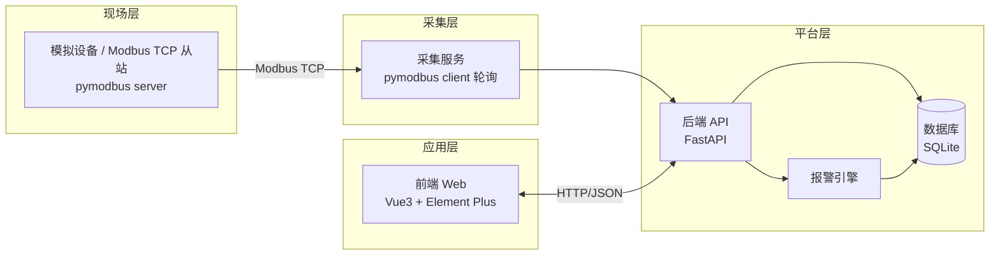

# 《工业软件与应用》共同项目设定与工具栈

> 来源：课程教材 PDF 第 11–14 页（原文件名 `01_项目设定与工具栈.md`）  
> 说明：本文件是全书共享基准，所有章节的代码、数据、命名都以此为准。  
> 整理日期：按教材原文整理，字段与约定未擅自增删。

---

## 一、项目定义

**项目名称：** 设备云监 · 工业设备监控与运维管理系统

**一句话：** 从一台「模拟设备」（Modbus 从站）采集实时数据，在 Web 端实现设备监控、报警、台账、工单与运维管理，并完成部署与上线。

**目标用户：** 工厂设备管理员、运维工程师、班组长。

### 功能清单

1. **设备台账：** 设备编号、名称、型号、位置、状态、责任人。
2. **实时监控：** 通过 Modbus 采集温度、转速、运行状态、产量计数等，实时刷新。
3. **报警管理：** 阈值/位报警，产生报警记录，确认与消警。
4. **巡检/报修工单：** 创建、派发、处理、关闭，记录处理过程。
5. **备件管理：** 备件库存、出入库记录。
6. **统计报表：** 设备利用率、报警统计、工单统计。
7. **（加分）智能预警：** 基于历史数据的异常检测或趋势预警。

### 非功能需求

单机可运行、开源免费、跨平台（Windows 为主）、采集延迟秒级即可、代码可读可维护。

---

## 二、系统架构



---

## 三、Modbus 数据采集设计

- **通信方式：** Modbus TCP，本地回环（`127.0.0.1`），端口 **5020**（避免 502 的管理员权限）。

### 模拟设备寄存器点位表（基准版）

| 数据类型 | 地址 | 名称 | 含义 | 单位/取值 |
|----------|------|------|------|-----------|
| 保持寄存器 (HR, 4x) | 40001 | temperature | 设备温度 | ℃ × 10（如 325 = 32.5℃） |
| 保持寄存器 (HR, 4x) | 40002 | speed | 转速 | rpm |
| 保持寄存器 (HR, 4x) | 40003 | output_count | 产量计数 | 件 |
| 保持寄存器 (HR, 4x) | 40004 | run_status | 运行状态 | 0 停机 / 1 运行 / 2 故障 |
| 离散输入 (DI, 1x) | 10001 | door_open | 安全门是否打开 | 0/1 |
| 线圈 (Coil, 0x) | 00001 | start_cmd | 启动命令（可写） | 0/1 |
| 线圈 (Coil, 0x) | 00002 | stop_cmd | 停止命令（可写） | 0/1 |

**说明：**

- 地址展示为 Modbus 传统表示法（1 基、带前缀）；pymodbus 内部地址为 0 基偏移（如 40001 → 偏移 0）。
- 功能码：读 HR 用 03，读 DI 用 02，读写线圈用 01/05，写 HR 用 06/16。
- **采集策略：** 采集服务每 1–2 秒轮询一次，写入 `telemetry` 表（时序数据）；同时做阈值判断触发报警。

---

## 四、技术栈（全开源免费，纯软件）

| 层次 | 选型 | 说明 |
|------|------|------|
| 语言 | Python 3.11+、Node.js 20+ | 后端与采集用 Python，前端构建用 Node |
| 工业通信 | pymodbus（BSD） | Modbus TCP/RTU 客户端与服务器 |
| 后端框架 | FastAPI + Uvicorn（MIT） | 异步 Web API |
| 数据校验 | Pydantic（MIT） | 请求/响应模型 |
| ORM | SQLAlchemy（MIT） | 可选，或用原生 sqlite3 |
| 数据库 | SQLite（公有领域） | 单文件、零安装；可升级 PostgreSQL |
| 前端 | Vue 3 + Vite（MIT） | 单页应用 |
| UI 组件 | Element Plus（MIT） | 表格、表单、图表容器 |
| 图表 | ECharts（Apache-2.0） | 实时曲线与统计图 |
| AI 助手 | 国产 AI 补全插件（CodeGeeX 主选 / Fitten Code 备选）+ 在线对话 | 开发期工具，个人版免费 |
| 版本管理 | Git（GPL）+ Gitea（MIT）或 GitHub | 代码托管 |
| 测试 | pytest、Vitest、Playwright | 单元/集成/端到端 |
| 部署 | Docker Compose 或 Podman | 一键部署 |
| 制图 | Mermaid、draw.io、Excalidraw | 架构/ER/流程图 |
| 文档 | Markdown + MkDocs（BSD） | 文档站 |

**说明：** AI 辅助工具属开发期工具，不纳入交付物的开源许可与运行依赖要求，也不得成为系统运行时依赖。交付系统本身仍为纯开源、单机可运行。

---

## 五、代码仓库结构约定

```text
device-cloud/
├─ backend/                 # FastAPI 后端
│  ├─ app/
│  │  ├─ main.py            # 应用入口
│  │  ├─ models.py          # 数据模型
│  │  ├─ schemas.py         # Pydantic 模型
│  │  ├─ database.py        # 数据库连接
│  │  ├─ routers/           # 路由：devices/alarms/workorders/spares/stats
│  │  └─ services/
│  │     ├─ collector.py    # Modbus 采集服务
│  │     └─ alarm.py        # 报警引擎
│  ├─ tests/                # pytest 测试
│  ├─ requirements.txt
│  └─ Dockerfile
├─ simulator/               # Modbus 从站模拟器
│  └─ device_server.py
├─ frontend/                # Vue3 前端
│  ├─ src/
│  │  ├─ api/               # 接口封装
│  │  ├─ views/             # 页面：Dashboard/Devices/Alarms/WorkOrders
│  │  └─ components/
│  ├─ package.json
│  └─ Dockerfile
├─ docs/                    # 文档（README、用户手册、发布说明）
├─ docker-compose.yml
└─ README.md
```

**命名规范：**

- Python 用 `snake_case`
- Vue/JS 组件用 `PascalCase`
- 接口路径用复数小写（`/api/devices`）
- 数据库表用单数小写（`device`、`alarm`、`work_order`、`telemetry`）

---

## 六、核心数据表（基准版）⭐ 第 3 周 ER/DDL 必须严格对齐

> **约束：** 字段名、表名必须与本节完全一致，不得自行新增表或字段。

1. **device：** `id`, `code`, `name`, `model`, `location`, `owner`, `status`, `created_at`
2. **telemetry：** `id`, `device_id`, `ts`, `temperature`, `speed`, `output_count`, `run_status`
3. **alarm：** `id`, `device_id`, `type`, `level`, `message`, `ts`, `acked`(bool), `cleared_at`
4. **work_order：** `id`, `device_id`, `type`(巡检/报修), `title`, `status`, `assignee`, `content`, `created_at`, `closed_at`
5. **spare_part：** `id`, `name`, `spec`, `qty`, `location`
6. **spare_record：** `id`, `part_id`, `type`(in/out), `qty`, `ts`, `note`

### 关系提示（写 ER 时用）

- `telemetry.device_id` → `device.id`
- `alarm.device_id` → `device.id`
- `work_order.device_id` → `device.id`
- `spare_record.part_id` → `spare_part.id`

### DDL 注意点（实验指导书补充要求）

- 表名单数小写；外键命名 `xxx_id`
- `temperature` 用 `REAL`；`acked` 用 `INTEGER`(0/1)；`ts` 用 `DATETIME`
- `device.code` 加 `UNIQUE`
- `telemetry` 加 `(device_id, ts)` 联合索引；`alarm` 加 `ts` 索引
- 不要加 `version` / `deleted_at` / 审计表

---

## 七、AI 使用规范（全书通用）

1. AI 是「结对同事」不是「代写」：先理解，再采纳。
2. 提示词「三段式」：给背景（我们的项目与约定）→ 说明任务与约束 → 要求先给方案再给代码。
3. 所有 AI 输出必须验证：能跑通、能解释、符合本文件约定。
4. 数据合规：课程虚构数据与通用技术问题可以交；真实生产数据、密钥凭据、未公开代码禁止外发。补全插件默认持续上传代码片段，处理敏感内容时先禁用插件。（详见第 09 周 9.5 节）
5. 每次关键使用记录到《AI 协作日志》：prompt、产出、采纳/驳回理由。补全生成的代码须在源码标注 `# AI 补全`。
