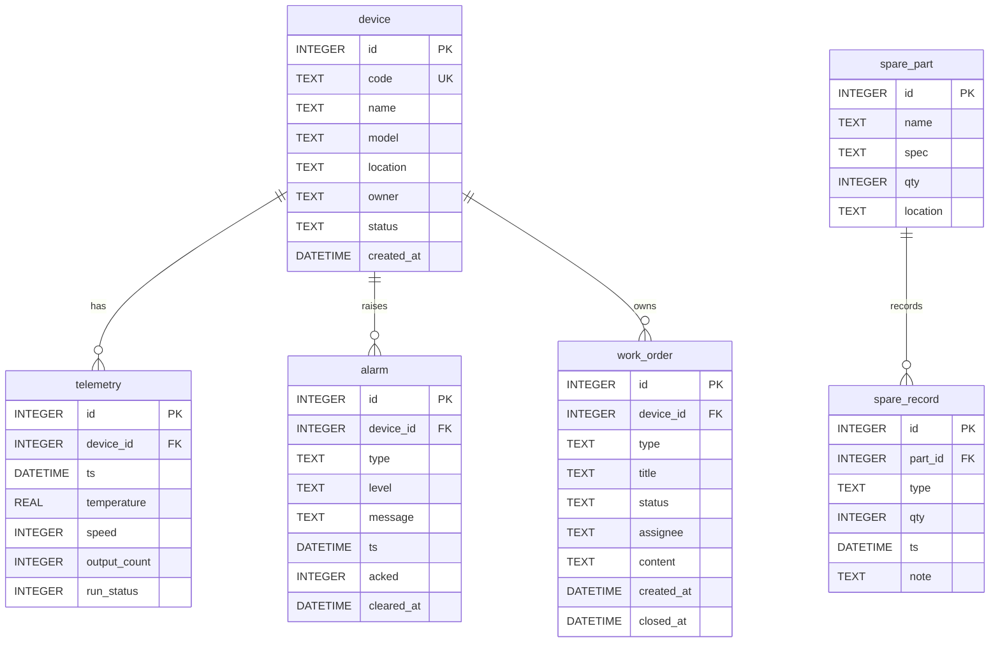

# 设备云监 · ER 图与 DDL

> 第 3 周任务一。字段严格对齐 `01_项目设定与工具栈.md` 第六节，未新增表/字段。  
> 验证：Mermaid 可渲染；DDL 已在临时 SQLite 中执行通过。

## 1. ER 图（Mermaid）



### 关系线依据

| 关系 | 依据 |
|------|------|
| `device \|\|--o{ telemetry` | `telemetry.device_id` → `device.id`（一台设备多条遥测） |
| `device \|\|--o{ alarm` | `alarm.device_id` → `device.id`（一台设备多条报警） |
| `device \|\|--o{ work_order` | `work_order.device_id` → `device.id`（一台设备多张工单） |
| `spare_part \|\|--o{ spare_record` | `spare_record.part_id` → `spare_part.id`（一种备件多条出入库） |

## 2. SQLite DDL

```sql
-- 请在目标数据库连接中、事务开始前启用外键检查。
-- SQLite 的外键检查设置按连接生效，新连接需要重新执行。
PRAGMA foreign_keys = ON;

-- 时间字段统一声明为 DATETIME。
-- SQLite 没有独立的日期时间存储类型；
-- 本项目统一以 TEXT 值保存，格式为 YYYY-MM-DD HH:MM:SS，
-- 时间口径统一为 UTC，写入时由应用层保证。

BEGIN TRANSACTION;

-- 1. 设备台账
CREATE TABLE device (
    id          INTEGER PRIMARY KEY,
    code        TEXT NOT NULL UNIQUE,
    name        TEXT,
    model       TEXT,
    location    TEXT,
    owner       TEXT,
    status      TEXT,
    created_at  DATETIME
);

-- 2. 设备遥测
CREATE TABLE telemetry (
    id            INTEGER PRIMARY KEY,
    device_id     INTEGER NOT NULL,
    ts            DATETIME,
    temperature   REAL,
    speed         INTEGER,
    output_count  INTEGER,
    run_status    INTEGER,

    FOREIGN KEY (device_id) REFERENCES device (id)
);

-- 3. 报警
CREATE TABLE alarm (
    id          INTEGER PRIMARY KEY,
    device_id   INTEGER NOT NULL,
    type        TEXT,
    level       TEXT,
    message     TEXT,
    ts          DATETIME,
    acked       INTEGER NOT NULL DEFAULT 0
                CHECK (acked IN (0, 1)),
    cleared_at  DATETIME NULL,

    FOREIGN KEY (device_id) REFERENCES device (id)
);

-- 4. 巡检/报修工单
CREATE TABLE work_order (
    id          INTEGER PRIMARY KEY,
    device_id   INTEGER NOT NULL,
    type        TEXT CHECK (type IN ('巡检', '报修')),
    title       TEXT,
    status      TEXT,
    assignee    TEXT,
    content     TEXT,
    created_at  DATETIME,
    closed_at   DATETIME NULL,

    FOREIGN KEY (device_id) REFERENCES device (id)
);

-- 5. 备件主数据
CREATE TABLE spare_part (
    id        INTEGER PRIMARY KEY,
    name      TEXT,
    spec      TEXT,
    qty       INTEGER,
    location  TEXT
);

-- 6. 备件出入库记录
CREATE TABLE spare_record (
    id       INTEGER PRIMARY KEY,
    part_id  INTEGER NOT NULL,
    type     TEXT CHECK (type IN ('in', 'out')),
    qty      INTEGER,
    ts       DATETIME,
    note     TEXT,

    FOREIGN KEY (part_id) REFERENCES spare_part (id)
);

-- 按设备和时间查询遥测数据时使用。
CREATE INDEX idx_tel_dev_ts
    ON telemetry (device_id, ts);

-- 按时间查询或统计报警时使用。
CREATE INDEX idx_alarm_ts
    ON alarm (ts);

COMMIT;
```

## 3. 人工核对摘要

- 六表齐全：`device` / `telemetry` / `alarm` / `work_order` / `spare_part` / `spare_record`
- 字段与 `01` 第六节一致，无 `version` / `deleted_at` / 审计表
- `temperature` = `REAL`；`acked` = `INTEGER`(0/1)；`cleared_at` 可为 NULL
- `code TEXT NOT NULL UNIQUE`；`CREATE INDEX idx_tel_dev_ts`；`CREATE INDEX idx_alarm_ts`
