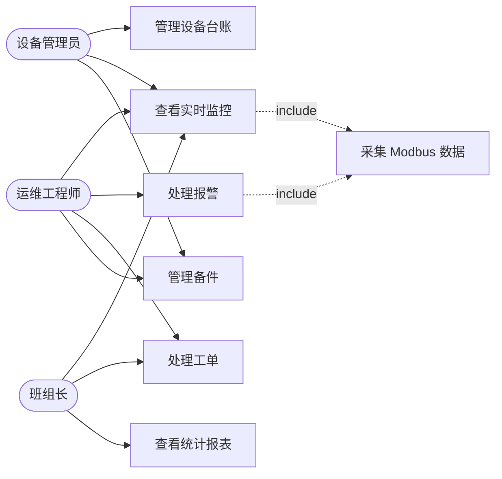

# 设备云监 · 用例图

> 参与者：设备管理员、运维工程师、班组长。  
> **说明：** 指导书要求用 **Mermaid**（`flowchart`）模拟用例图。  
> 在 VS Code / Cursor 打开本文件，按 **`Ctrl+Shift+V`** 预览即可出图。  
> 若必须用 PlantUML 在线站：请打开同目录 **`use_case.puml`** 全选复制（不要复制本文的 \`\`\` 符号）。

## 参与者与用例关系（Mermaid · 课程主用）



## 说明

| 类型 | 内容 |
|------|------|
| 参与者（3） | 设备管理员、运维工程师、班组长 |
| 主用例（6） | 管理设备台账、查看实时监控、处理报警、处理工单、查看统计报表、管理备件 |
| include | 「查看实时监控」「处理报警」均 **include**「采集 Modbus 数据」（端口 5020） |

## 人工修正记录

1. AI 易增加「系统管理员 / 访客」→ **删除**。  
2. AI 易漏 include → **补上** UC2/UC3 → 采集 Modbus。  
3. 用例名用用户目标（管理/查看/处理），不用「点击按钮」。

---

## PlantUML 备用

你截图里的错误原因：

1. `<<include>>` 被网页吃掉，变成了 `: <>`（无效）  
2. 末尾多粘了 Markdown 的 \`\`\`  
3. 应用 **整段** `@startuml`～`@enduml`，不要只贴后半段  

下面标签改用普通文字 `include`（避免 `<< >>` 被吞）。**复制时只复制代码，不要复制围栏。**

更稳妥：打开 `docs/use_case.puml` → Ctrl+A → Ctrl+C → 粘贴到在线编辑器。

```
@startuml
left to right direction

actor "设备管理员" as Admin
actor "运维工程师" as Ops
actor "班组长" as Lead

rectangle "设备云监" {
  usecase "管理设备台账" as UC1
  usecase "查看实时监控" as UC2
  usecase "处理报警" as UC3
  usecase "处理工单" as UC4
  usecase "查看统计报表" as UC5
  usecase "管理备件" as UC6
  usecase "采集Modbus数据" as UC7
}

Admin --> UC1
Admin --> UC2
Ops --> UC2
Lead --> UC2
Ops --> UC3
Ops --> UC4
Lead --> UC4
Lead --> UC5
Admin --> UC6
Ops --> UC6

UC2 ..> UC7 : include
UC3 ..> UC7 : include

@enduml
```
